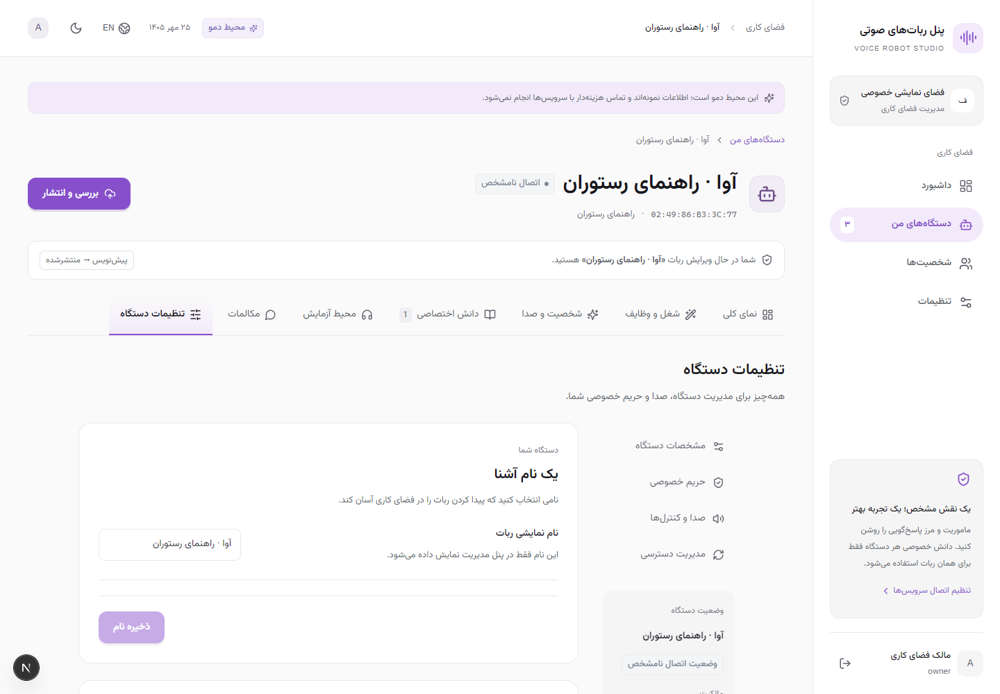

# ESP Voice Robot Studio

Qwen cloud is supported for text, voice samples, browser push-to-talk tests,
device-scoped local knowledge, and physical robot conversations. Start with the
[Persian Qwen setup guide](docs/qwen-setup.fa.md), [companion source](companion/README.md),
and [validation report](docs/qwen-validation.md). API keys stay on the server.

[](https://github.com/shadigivian/esp-voice-robot-studio/actions/workflows/ci.yml)

A management dashboard for independent ESP voice robots, with Persian RTL and English LTR interfaces. Manage robot identities, character and voice settings, private knowledge, conversations and access from one workspace.



## Features

- Responsive light and dark interfaces, mobile navigation and keyboard-accessible dialogs.
- Per-device character, voice and knowledge configuration, with separate drafts and published versions.
- Device pairing, credential rotation, heartbeat status and acknowledged commands.
- Private PDF, text and Markdown uploads with review, approval and indexing steps.
- Workspace owner, administrator and viewer permissions through Supabase Auth.
- Transcript storage disabled by default, configurable retention and server-side usage limits.
- Text Playground, optional browser voice and an optional adapter for an existing compatible ElatoAI Deno voice server.
- An isolated local demo that needs no API keys, database or physical robot.

## Run the demo

Install Git, **Node.js 22.13 or newer**, and npm. From PowerShell, macOS or Linux:

```sh
git clone https://github.com/shadigivian/esp-voice-robot-studio.git
cd esp-voice-robot-studio
npm ci
npm run demo
```

Open **http://127.0.0.1:3100/login** and choose the labeled demo entry. Each login receives its own synthetic workspace with three sample robots. The demo makes no provider requests, connects to no production database and opens no live voice session. Its data resets when the process restarts. Stop it with `Ctrl+C`.

**شروع سریع فارسی:** دستورهای بالا را اجرا کن، آدرس محلی را باز کن و گزینهٔ ورود دمو را بزن. برای دمو نیازی به کلید API نیست. برای استفادهٔ واقعی، کلیدها را فقط در فایل `.env.local` روی سرور وارد کن.

## Connect real services

Follow the complete [setup guide](docs/setup.md). Copy [.env.example](.env.example) to `.env.local`, then configure your own PostgreSQL database, Supabase Auth and explicitly available provider models. The file is excluded from Git. The Integrations screen reports and tests configuration; it does not store API keys entered through the browser.

After reviewing the migration and choosing the intended database:

```sh
npm run migrate
npm run operator -- workspace USER_UUID WorkspaceName
npm run dev
```

Replace `USER_UUID` with an existing Supabase Auth user. Run `npm run worker` in a second terminal for document indexing, retention cleanup and pending cleanup work. Each physical robot needs its own securely provisioned bootstrap identity; a MAC address alone does not authenticate it.

For production, use a persistent Node server, PostgreSQL, private storage, a worker and an HTTPS reverse proxy. `npm run build` followed by `npm start` serves the app on loopback port 3100. Publishing this source repository does not host the application or configure these services.

## Checks

```sh
npm run typecheck
npm run lint
npm test
npm run test:ui
npm run build
```

Browser tests use Playwright and an installed Google Chrome browser. They start or reuse a local demo and verify that demo mode is enabled before changing synthetic data. `TEST_APP_BASE_URL=http://127.0.0.1:3100` enables the HTTP lifecycle test against a separately started demo. `TEST_DATABASE_URL` enables the transaction test against an explicitly chosen migrated test database.

Default tests do not make paid model requests or operate hardware. See the [test report](docs/test-report.md) and [UI review](docs/ui-ux-review.md) for the scope of recorded verification. `npm run ui:capture` captures a running local demo; generated evidence stays under ignored `.local/`.

## Documentation and integration boundaries

- [Setup and operation](docs/setup.md)
- [Architecture](docs/architecture.md)
- [Private knowledge and isolation](docs/knowledge-isolation.md)
- [Device protocol and simulator](docs/device-protocol.md)
- [Optional existing Deno server integration](docs/integration-contract.md)
- [Hardware profile example](hardware-profile.example.json)
- [Historical companion firmware verification](docs/firmware-verification.md)

This repository contains the management app, simulator, managed adapter, and companion Arduino firmware source for the documented ESP32-S3 circuit. The full ElatoAI voice server remains separate; the companion installer integrates its existing listener. Hardware wiring, OLED rendering, secure board provisioning, deployed certificates and real microphone/speaker behavior require separate validation. Live provider access and native Deno deployment are not established by the local demo or deterministic tests. The application uses a small-installation transaction model; review the architecture before operating a large fleet.

## License and attribution

MIT licensed; see [LICENSE](LICENSE). This project was extracted from management work alongside [ElatoAI](https://github.com/akdeb/ElatoAI) and preserves its attribution. The bundled Vazirmatn font uses the SIL Open Font License. See [third-party notices](THIRD_PARTY_NOTICES.md).
